# ong-vida-plena

## 1. Apresentação do projeto

O projeto ONG Vida Plena consiste no desenvolvimento
de um sistema web para gerenciamento de eventos,
beneficiários e histórico de participações.

## 2. Problema identificado

A utilização de planilhas manuais e grupos de WhatsApp
dificulta a organização das informações, ocasionando
duplicidade de dados, perda de registros e dificuldades
no acompanhamento dos beneficiários.

## 3. Objetivo do sistema

Centralizar as informações em uma plataforma digital,
facilitando o gerenciamento dos eventos, o cadastro
dos beneficiários e o controle das participações.

O sistema também busca proporcionar maior segurança
e rastreabilidade das operações por meio de autenticação
individual e registros automáticos de auditoria.

## 4. Funcionalidades do sistema

### 4.1 Autenticação de funcionários

- Login individual por e-mail e senha.
- Identificação do funcionário conectado.
- Controle de acesso ao painel administrativo.
- Encerramento da sessão (logout).

### 4.2 Gerenciamento de eventos

- Cadastro de eventos.
- Visualização dos eventos cadastrados.
- Seleção e exclusão de eventos.
- Confirmação antes da exclusão.

### 4.3 Gerenciamento de beneficiários

- Cadastro de beneficiários com nome, idade, contato e região.
- Validação dos campos obrigatórios.
- Armazenamento dos dados no Supabase.
- Visualização dos beneficiários cadastrados.
- Seleção e exclusão de beneficiários.
- Confirmação antes da exclusão.
- Identificação do funcionário responsável pelo cadastro.
- Registro automático das operações na tabela de auditoria.

### 4.4 Gerenciamento de participações

- Inscrição de beneficiários em eventos.
- Participação em múltiplos eventos.
- Visualização do histórico de participações.
- Cancelamento de inscrições.

### 4.5 Auditoria e rastreabilidade

- Registro automático de cadastros e exclusões.
- Identificação do funcionário responsável.
- Identificação da tabela e do registro afetado.
- Registro da data e hora da operação.
- Restrição de acesso direto aos registros de auditoria.

### 4.6 Interface do sistema

- Interface organizada e intuitiva.
- Layout responsivo para computadores e celulares.
- Destaque visual dos registros selecionados.
- Mensagens de confirmação e validação.
- Diferenciação visual dos botões de cadastro e exclusão.

## 5. Tecnologias e ferramentas utilizadas

### 5.1 Visual Studio Code

Utilizado como ambiente de desenvolvimento do sistema.

A escolha foi motivada pela flexibilidade, facilidade
de manutenção, integração com Git e possibilidade
de personalização da aplicação.

### 5.2 HTML

Utilizado para estruturar as páginas, formulários,
listas e elementos da interface do sistema.

### 5.3 CSS

Utilizado para personalizar a aparência do sistema,
organizar os componentes e adaptar a interface
para diferentes tamanhos de tela.

### 5.4 JavaScript

Utilizado para implementar as funcionalidades,
validações, interações com o usuário e comunicação
com o banco de dados.

### 5.5 Supabase

Utilizado como plataforma de backend, oferecendo:

- Banco de dados PostgreSQL.
- Autenticação de usuários.
- Controle de acesso por RLS.
- Armazenamento persistente dos registros.
- Funções e gatilhos de auditoria.

A escolha do Supabase permitiu reduzir a complexidade
da implementação de um backend próprio.

### 5.6 Git

Utilizado para o controle de versão do projeto,
permitindo acompanhar as alterações realizadas
durante o desenvolvimento.

## 6. Justificativa e limitações das ferramentas

A utilização do VS Code em conjunto com o Supabase
permitiu maior controle sobre a interface, as regras
de funcionamento e a segurança dos dados.

Diferentemente de plataformas exclusivamente No-Code,
essa abordagem possibilitou personalizações manuais
e maior compreensão da estrutura da aplicação.

Entretanto, a solução apresenta algumas limitações:

- Necessidade de conhecimentos básicos de programação.
- Dependência de conexão com a internet para acessar
  os serviços do Supabase.
- Limitações de recursos do plano gratuito.
- Necessidade de manutenção do código e das políticas
  de segurança.

  ## 7. Arquitetura do sistema

O sistema utiliza uma arquitetura composta por
interface web e serviços de backend em nuvem.

A interface foi desenvolvida utilizando HTML,
CSS e JavaScript, enquanto o Supabase é responsável
pela autenticação e pelo armazenamento dos dados.

A comunicação entre a interface e o banco de dados
é realizada por meio da biblioteca Supabase JS.

## 8. Estrutura do banco de dados

O banco de dados PostgreSQL possui quatro tabelas
principais:

### 8.1 Eventos

Responsável pelo armazenamento dos eventos
cadastrados pela ONG.

### 8.2 Beneficiários

Responsável pelo armazenamento dos beneficiários
atendidos pela organização.

A tabela possui os seguintes atributos:

- id: identificador único do beneficiário.
- nome: nome do beneficiário.
- idade: idade do beneficiário.
- contato: informação de contato.
- regiao: região de residência.
- criado_em: data e hora do cadastro.
- criado_por: identificador do funcionário responsável.

O formulário realiza a validação dos campos
obrigatórios antes do envio ao banco de dados.

O armazenamento é realizado no Supabase,
permitindo a integração entre a interface
visual e o banco de dados PostgreSQL.

### 8.3 Participações

Responsável pelo relacionamento entre beneficiários
e eventos, permitindo que um beneficiário participe
de múltiplos eventos.

### 8.4 Auditoria

Responsável pelo registro automático das operações
de inclusão e exclusão realizadas no sistema.

Cada registro de auditoria contém:

- Identificador do funcionário.
- Tipo de operação realizada.
- Tabela afetada.
- Identificador do registro.
- Data e horário da operação.

A auditoria utiliza funções e gatilhos do PostgreSQL,
permitindo registrar as operações diretamente
no banco de dados, sem depender exclusivamente
da interface da aplicação.

## 9. Segurança e controle de acesso

### 9.1 Autenticação

O sistema utiliza o Supabase Authentication para
autenticação individual dos funcionários por meio
de e-mail e senha.

O painel administrativo permanece oculto enquanto
o funcionário não estiver autenticado.

### 9.2 Gerenciamento de sessões

O sistema permite a recuperação automática da sessão
após a atualização da página.

Ao realizar o logout, a sessão é encerrada e o
painel administrativo é ocultado.

### 9.3 Segurança do banco de dados

A plataforma Supabase disponibiliza o mecanismo
Row Level Security (RLS), utilizado para controlar
o acesso aos registros do banco de dados.

A tabela de auditoria possui RLS habilitado e
não disponibiliza acesso direto aos funcionários.

### 9.4 Rastreabilidade das operações

Foram implementados três gatilhos de auditoria
nas tabelas de eventos, beneficiários e participações.

Esses gatilhos executam automaticamente a função
registrar_auditoria nas operações INSERT e DELETE.

A função utiliza auth.uid() para identificar
o funcionário responsável pela operação.

### 9.5 Integridade dos dados

O sistema possui mecanismos de validação para:

- Impedir cadastros com campos obrigatórios vazios.
- Impedir inscrições duplicadas no mesmo evento.
- Solicitar confirmação antes de excluir registros.
- Solicitar confirmação antes de cancelar inscrições.
- Identificar registros por identificadores únicos.

### 9.6 Limitações de segurança

A auditoria contempla atualmente operações de
inclusão e exclusão.

A solução foi desenvolvida para fins acadêmicos
e necessita de avaliações adicionais de segurança
antes de uma eventual utilização em produção.

## 10. Personalizações e decisões técnicas

Durante o desenvolvimento, foram realizadas
personalizações manuais para atender às necessidades
da ONG Vida Plena.

### 10.1 Personalização da interface

- Definição de uma identidade visual própria.
- Organização dos formulários e listas.
- Utilização da cor verde para ações de cadastro.
- Utilização da cor vermelha para ações de exclusão.
- Destaque visual dos registros selecionados.
- Adaptação da interface para dispositivos móveis.

### 10.2 Decisões técnicas

- Utilização de autenticação individual para
  identificar os funcionários responsáveis
  pelas operações.

- Utilização de um banco de dados relacional
  para organizar eventos, beneficiários
  e participações.

- Separação dos registros de participação
  em uma tabela específica para permitir
  o relacionamento entre múltiplos eventos
  e beneficiários.

- Implementação de confirmações antes das
  exclusões para reduzir erros operacionais.

- Implementação da auditoria diretamente
  no banco de dados para aumentar a
  confiabilidade dos registros.

### 10.3 Melhorias durante o desenvolvimento

Durante os testes, foram identificadas oportunidades
de melhoria na interface e no funcionamento do sistema.

Foram realizadas correções na exibição dos formulários,
na seleção dos registros, no comportamento da tela
de autenticação e na adaptação para dispositivos móveis.

Essas melhorias contribuíram para a usabilidade,
organização e confiabilidade da aplicação.

## 11. Testes e validações

Durante o desenvolvimento, foram realizados testes
funcionais e de interface para verificar o
comportamento da aplicação.

### 11.1 Autenticação

- Login com credenciais válidas.
- Tentativa de login com credenciais inválidas.
- Exibição do painel após autenticação.
- Identificação do funcionário conectado.

### 11.2 Operações do sistema

- Cadastro de eventos.
- Cadastro de beneficiários.
- Registro de participações.
- Exclusão de registros.
- Exibição de mensagens de confirmação.
- Validação de ações sem registros selecionados.

### 11.3 Auditoria

- Registro automático das operações de inclusão.
- Registro automático das operações de exclusão.
- Identificação do funcionário responsável.
- Verificação dos registros no banco de dados.
- Verificação dos três gatilhos de auditoria.
- Verificação da configuração de segurança da
  função registrar_auditoria.

### 11.4 Responsividade

A interface foi testada em computadores e por meio
da simulação de dispositivos móveis nas ferramentas
de desenvolvimento do navegador Opera.

Foi utilizado o perfil de tela do iPhone 16 para
verificar a organização dos elementos e a adaptação
da interface.

### 11.5 Resultados

Os testes realizados permitiram identificar e
corrigir problemas de interface e funcionamento.

As funcionalidades verificadas apresentaram
o comportamento esperado após as correções.

Os testes possuem escopo acadêmico e não substituem
uma avaliação completa de segurança, desempenho
e compatibilidade.

## 12. Evidências do desenvolvimento e dos testes

As capturas documentam a evolução e os testes da aplicação. Informações identificadoras foram ocultadas em algumas imagens.

### 12.1 Primeira versão da interface (17/11)

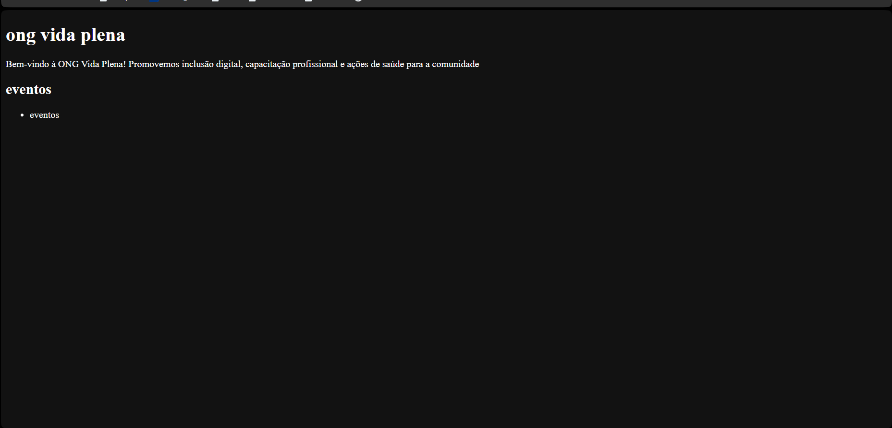

### 12.2 Tela de autenticação

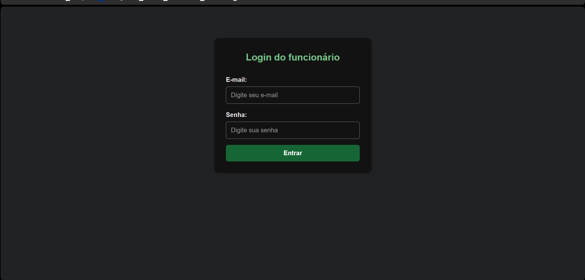

### 12.3 Rejeição de credenciais inválidas

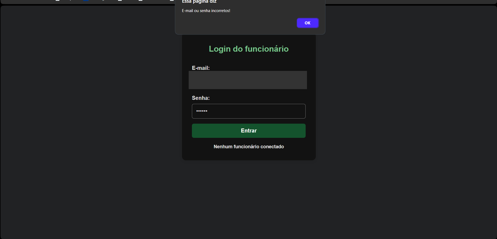

### 12.4 Painel após autenticação

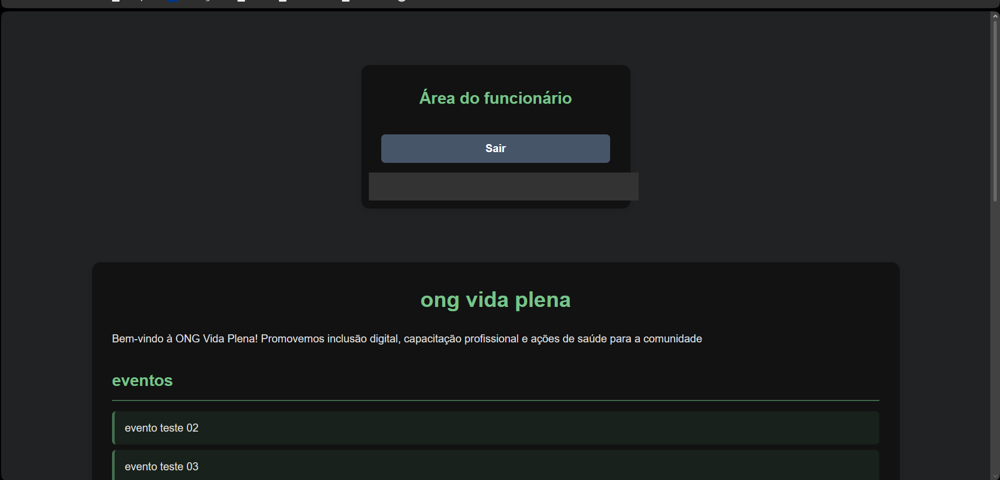

### 12.5 Listagem e cadastro de eventos

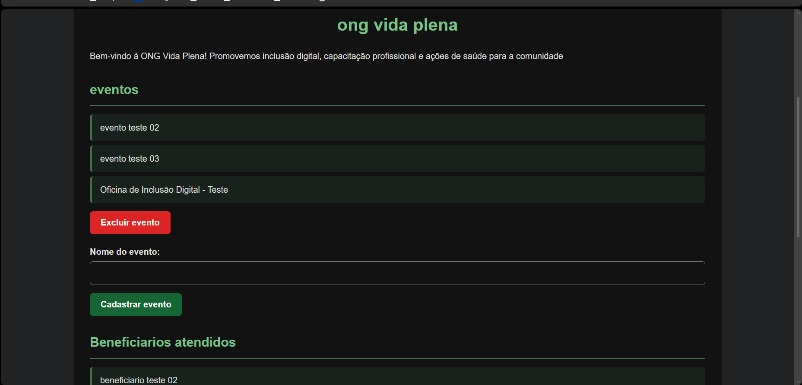

### 12.6 Confirmação de cadastro de beneficiário

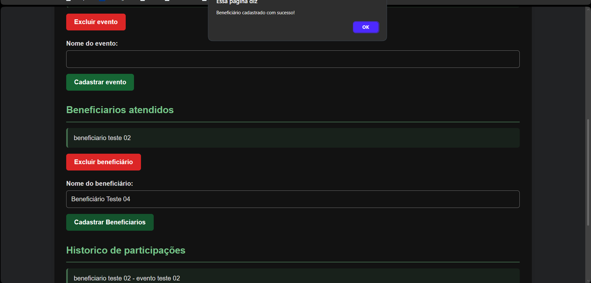

### 12.7 Confirmação de inscrição

### 12.8 Histórico com múltiplos eventos e bloqueio de inscrição duplicada

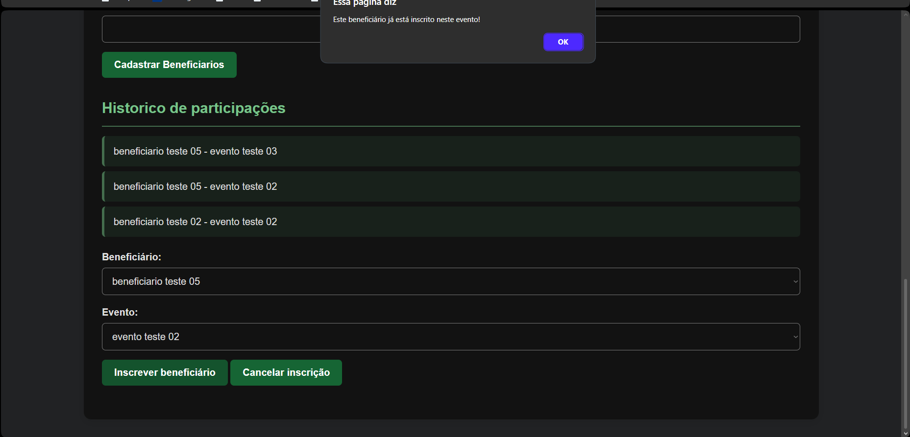

### 12.9 Confirmação de cancelamento de inscrição

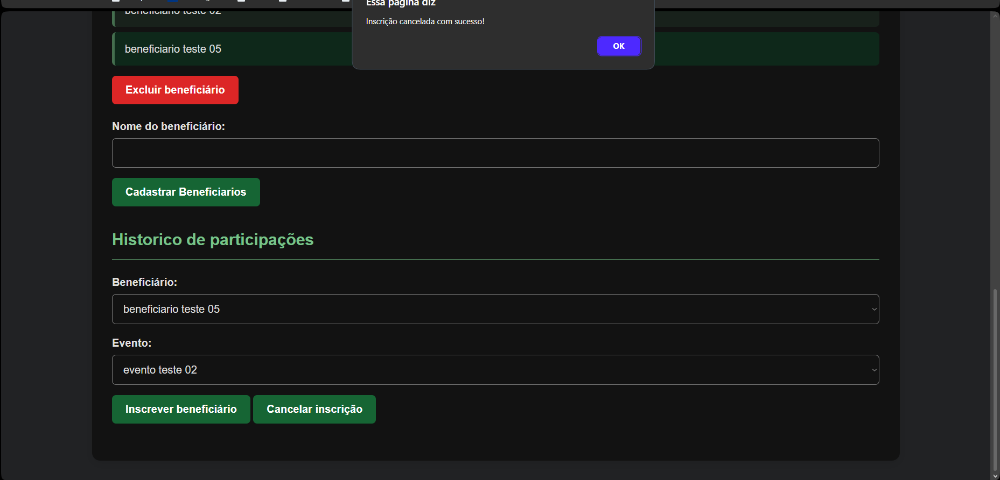

### 12.10 Confirmação antes de excluir evento

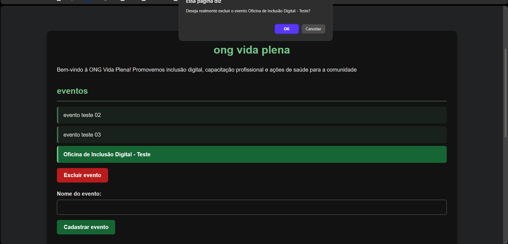

### 12.11 Simulação de tela móvel

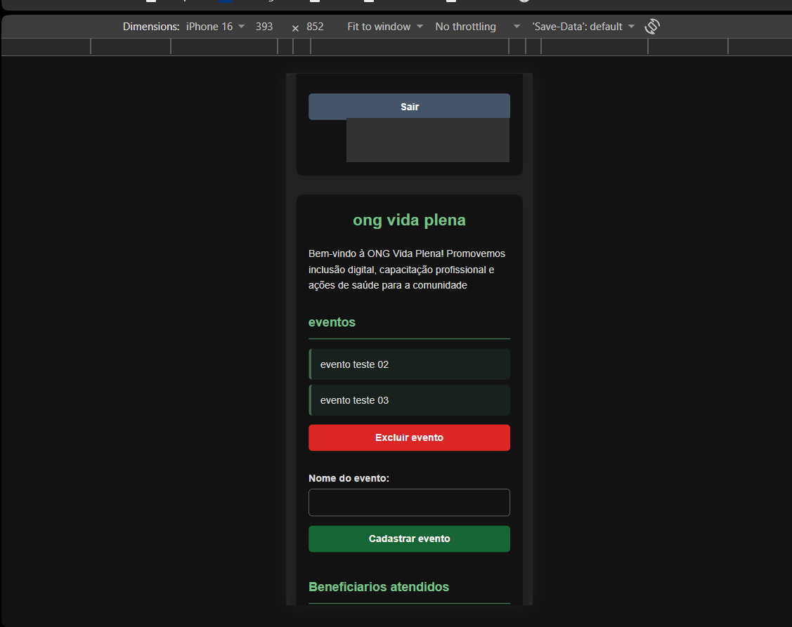

### 12.12 Registros de inclusão e exclusão

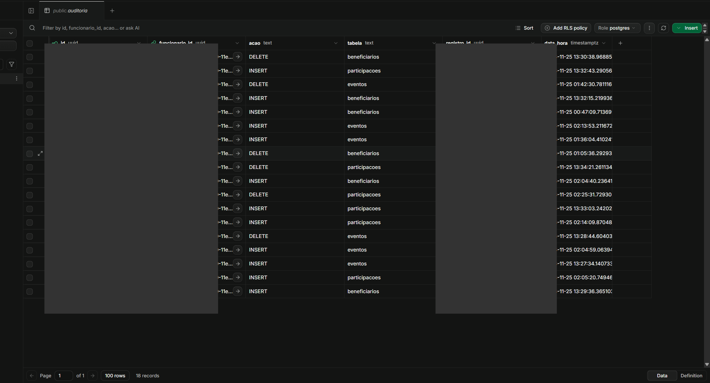

### 12.13 Três gatilhos de auditoria habilitados

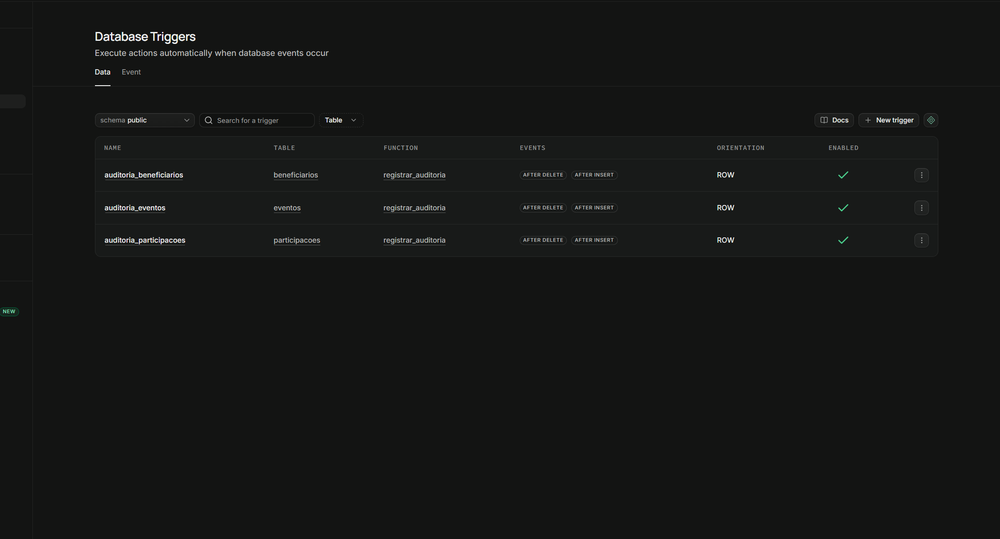

### 12.14 Restrição de acesso à tabela de auditoria

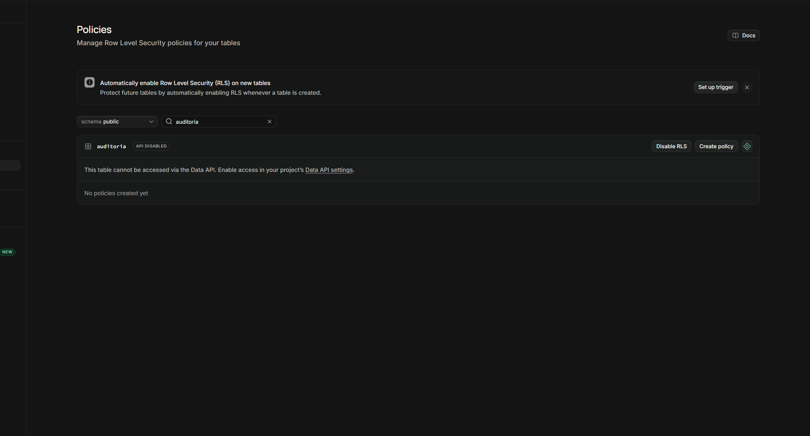

### 12.15 Verificação do search_path da função

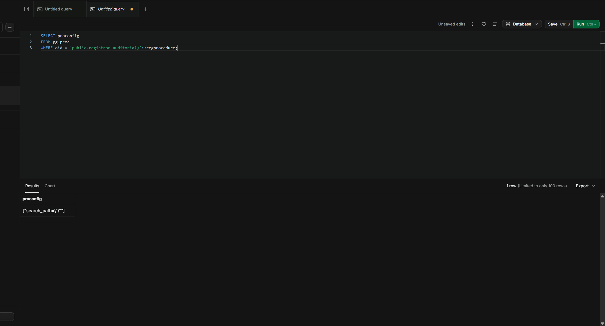

### 12.16 Cadastro completo de beneficiários

Demonstração do cadastro de beneficiários com nome,
idade, contato e região, conforme os requisitos
do projeto.

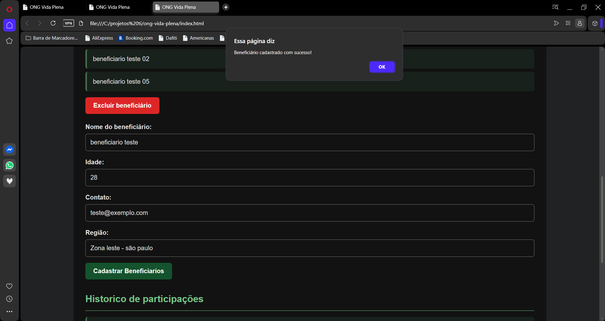

### 12.17 Integração com o banco de dados

Comprovação do armazenamento dos dados dos
beneficiários no Supabase, demonstrando a integração
entre a aplicação visual e o banco de dados PostgreSQL.

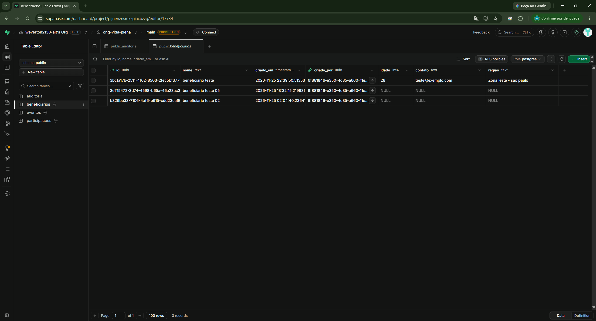

## 13. Instruções de acesso e utilização

### 13.1 Requisitos para execução

- Navegador web atualizado.
- Conexão ativa com a internet.
- Arquivos do projeto disponíveis.
- Serviço Supabase ativo e configurado.
- Credenciais de acesso autorizadas.

### 13.2 Execução da aplicação

1. Baixar os arquivos do projeto.
2. Manter a estrutura original de arquivos e pastas.
3. Abrir o arquivo index.html no navegador.
4. Informar as credenciais de acesso disponibilizadas
   para a avaliação.
5. Realizar a autenticação para acessar o painel.

### 13.3 Utilização do sistema

Após a autenticação, o usuário poderá:

- Cadastrar e consultar eventos.
- Cadastrar e consultar beneficiários.
- Inscrever beneficiários em eventos.
- Consultar o histórico de participações.
- Cancelar inscrições.
- Excluir registros conforme as regras do sistema.
- Encerrar a sessão de acesso.

### 13.4 Orientações para avaliação

As credenciais de teste deverão ser disponibilizadas
separadamente, evitando a exposição de senhas na
documentação pública do projeto.

Recomenda-se utilizar dados fictícios durante os
testes das funcionalidades.

## 14. Possibilidades de melhorias futuras

Embora o sistema contemple as principais necessidades
identificadas, existem possibilidades de evolução:

- Implementação de diferentes níveis de permissão.
- Desenvolvimento de relatórios e indicadores.
- Exportação de dados em PDF e CSV.
- Implementação de notificações automáticas.
- Ampliação dos testes de segurança e desempenho.
- Implementação de rotinas de backup e recuperação.
- Desenvolvimento de um painel administrativo de auditoria.

Essas melhorias representam possibilidades de evolução
e não fazem parte do escopo implementado nesta versão.

## 15. Conclusão

O desenvolvimento do sistema ONG Vida Plena permitiu
aplicar conhecimentos de desenvolvimento web, banco de
dados, autenticação, segurança e controle de versão.

A solução desenvolvida centraliza o gerenciamento de
eventos, beneficiários e participações, contribuindo
para a organização das informações e a redução de
registros duplicados.

A integração com o Supabase possibilitou o armazenamento
centralizado dos dados, o controle de acesso e a
rastreabilidade das operações.

O projeto também proporcionou experiência prática na
identificação de problemas, tomada de decisões técnicas,
implementação de funcionalidades, realização de testes
e elaboração de documentação.

A aplicação representa um protótipo acadêmico funcional,
com possibilidades de evolução para atender necessidades
operacionais mais abrangentes.